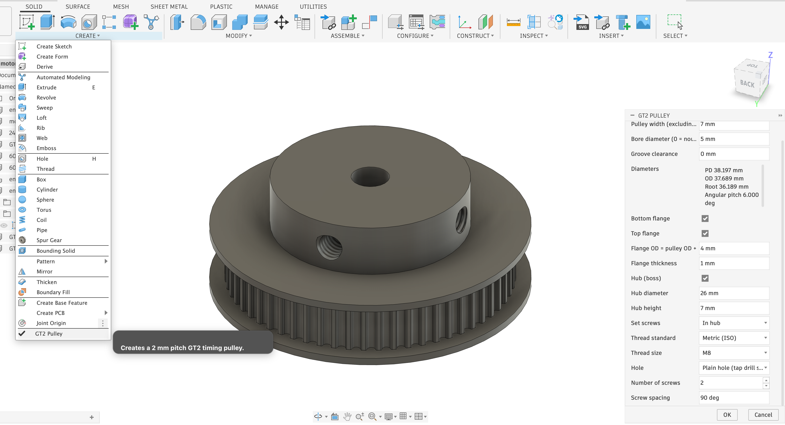

# GT2 Pulley Generator for Fusion 360

An Autodesk Fusion 360 add-in that generates 2 mm pitch GT2 timing pulleys for any tooth count, with optional flanges, a hub and threaded set screw holes. It adds a **GT2 Pulley** button to **Solid → Create**, next to Spur Gear.

## Install

1. Download or clone this repo.
2. Copy the `GT2Pulley` folder into Fusion's AddIns folder:
   - **Windows:** `%APPDATA%\Autodesk\Autodesk Fusion 360\API\AddIns\`
   - **macOS:** `~/Library/Application Support/Autodesk/Autodesk Fusion 360/API/AddIns/`

   Alternatively, in **Utilities → Add-Ins → Scripts and Add-Ins**, use **+** to add the `GT2Pulley` folder from wherever you cloned it.
3. In **Scripts and Add-Ins → Add-Ins**, select **GT2Pulley**, click **Run** and tick **Run on Startup**.

The button then appears under **Solid → Create → GT2 Pulley**. Pin it from that menu to put it on the toolbar.

## Options

| Option | What it does |
| --- | --- |
| Teeth | Tooth count (8–500). PD, OD and root diameter are shown live. |
| Pulley width (excluding hub) | Axial length of the toothed section. Use about 7 mm for a 6 mm belt, 10 mm for a 9 mm belt. |
| Bore diameter | Shaft bore; 0 for none. |
| Groove clearance | Enlarges the groove (tip and flank radii) without touching the OD, so pitch is unchanged. 0 for machined parts, 0.05–0.1 mm for FDM. |
| Bottom flange / Top flange | Flanges below and above the teeth. |
| Flange OD = pulley OD + | Diameter offset from the calculated OD (4 mm gives a 2 mm lip). |
| Flange thickness | Axial thickness of each flange. |
| Hub (boss) | Hub on top of the pulley (or top flange), with diameter and height. |
| Set screws | None, in the hub, or through the teeth (each hole centred on a groove). |
| Thread standard / size | Metric M2–M8, or imperial #4-40 to 1/4-20. |
| Hole | Plain hole at tap drill size, cosmetic thread, or modeled thread. |
| Number of screws / spacing | 1–4 screws; 90° default, 180° for opposed screws. Through-teeth spacing snaps to the nearest groove. |

## Geometry

Nominal 2GT belt profile (mm):

| Quantity | Value |
| --- | --- |
| Pitch | 2.000 |
| Pitch diameter (PD) | 2N / π |
| Pitch line differential (PLD) | 0.254 |
| Outside diameter (OD) | PD − 0.508 |
| Groove depth | 0.75 |
| Root diameter | OD − 1.50 |
| Tip radius | 0.555 |
| Flank radius | 1.00 |
| Groove edge fillet | 0.15 |

Each groove is built from the OD circle:

- **Tip arc:** R0.555, centred on the groove centreline at r_OD − 0.195, tangent to the root circle.
- **Flank arcs:** R1.00, centred on the OD circle about 0.40 mm either side of the centreline. Each centre swings the flank on the opposite side.
- **Fillets:** R0.15 between each flank and the OD.

The flank centres are solved exactly, on the OD circle and tangent to the tip arc, so the profile stays tangent at any tooth count. The 2GT profile itself is proprietary to Gates; these are the widely used nominal values.
